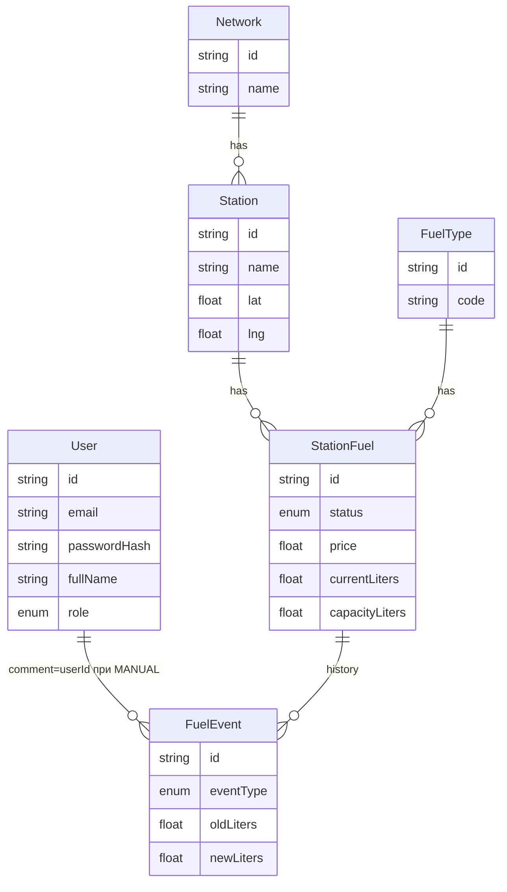

# FuelStation

Учебный веб-сервис мониторинга сетей АЗС: список и карта заправок, остатки топлива, роли пользователей, ручное обновление и суточная симуляция расхода.

## Стек

- **Backend:** Node.js, Express, JavaScript, Prisma, PostgreSQL, Zod, JWT, bcryptjs, node-cron
- **Frontend:** React, Vite, JavaScript, React Router, Yandex Maps JS API
- **Тесты:** Jest, Supertest
- **Инфра:** Docker Compose, Nginx (клиент), PostgreSQL 16

## Роли

| Роль | Возможности |
|------|-------------|
| **USER** | Регистрация, вход, просмотр списка, карты и карточки АЗС |
| **ADMIN** | Всё то же + PATCH остатков/цен и запуск симуляции |

Учётная запись из seed: `admin@gazprom.ru` / `admin123`.

## Структура папок (слои backend)

```
server/src/
  routes/        URL и middleware
  controllers/   req → service → res
  services/      бизнес-логика и Prisma
  schemas/       Zod
  middleware/    auth, роли, валидация, ошибки
  lib/           prisma, HttpError, расчёт статуса
client/src/
  api/ pages/ components/ hooks/ utils/
```

Сервис не знает про `req`/`res`. Контроллер тонкий. Ошибки — `throw` и `errorHandler`.

## Запуск через Docker

Скопируйте `.env.example` в `.env`, задайте пароль БД, `JWT_SECRET` и ключ Яндекс.Карт (переменная `VITE_YANDEX_MAPS_KEY`, сам ключ в git не кладём). Docker-сборка клиента ходит в API через Nginx (`/api` → `server:3000`), поэтому в образ не прошивается `localhost:3000`.

```bash
docker compose up -d --build
```

- Клиент: http://localhost:5173
- API: http://localhost:3000
- Health: http://localhost:3000/health
- Postgres внутри Compose слушает 5432; на хост пробрасывается `${POSTGRES_PORT:-5432}` (если 5432 занят локальным Postgres, задайте `POSTGRES_PORT=5433` в `.env`)

## Запуск локально без Docker

Нужен PostgreSQL (можно только сервис `db` из compose). В `server/.env` укажите `DATABASE_URL` и `JWT_SECRET`. В корневом `.env` — `VITE_API_URL` и `VITE_YANDEX_MAPS_KEY`.

```bash
cd server && npm install && npx prisma migrate dev && npx prisma db seed && npm run dev
```

```bash
cd client && npm install && npm run dev
```

Тесты (из `server`, БД должна быть доступна):

```bash
cd server && npm test
```

## Возможности

- Регистрация, вход, JWT на 7 дней, профиль `/api/v1/auth/me`
- Список АЗС с сетью и топливом, карточка станции, маршрут в Яндекс.Картах
- Фильтры: тип топлива, статус, адрес, радиус от геолокации
- Карта с метками; клик открывает карточку; точка «вы здесь»
- Админка: правка status / currentLiters / price
- Симуляция расхода (cron раз в сутки и POST для ADMIN)
- Журнал `FuelEvent` (MANUAL и SIMULATION)

## ERD



Связь User ↔ FuelEvent логическая: в поле `comment` пишется `userId` при ручном изменении.

## Скриншоты

Добавьте файлы после защиты интерфейса:

- `docs/screenshots/stations.png` — список и фильтры
- `docs/screenshots/map.png` — карта
- `docs/screenshots/detail.png` — карточка АЗС
- `docs/screenshots/admin.png` — админка

## Документы к отчётам

Папка `docs/`: требования, БД, API, деплой, архитектура, UX, вопросы к защите.

## Идеи на будущее

- Поиск ближайшей АЗС с нужным топливом на сервере
- Уведомления, когда топливо переходит в LOW / OUT
- Несколько городов и сети с логотипами
- История цен на графике
- Восстановление пароля и refresh-токены
